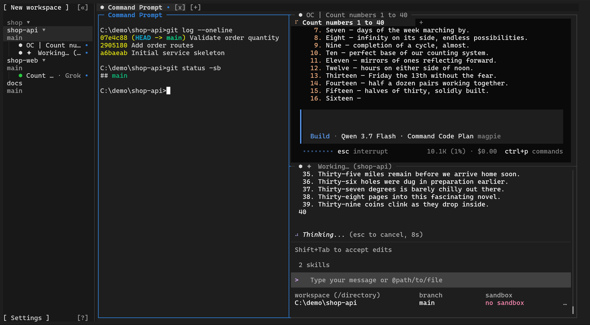
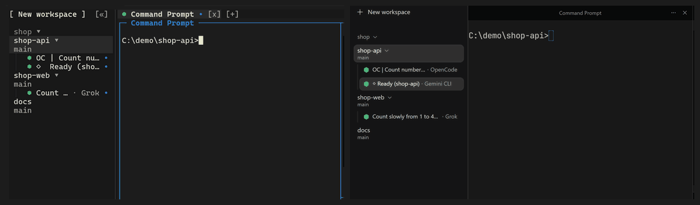
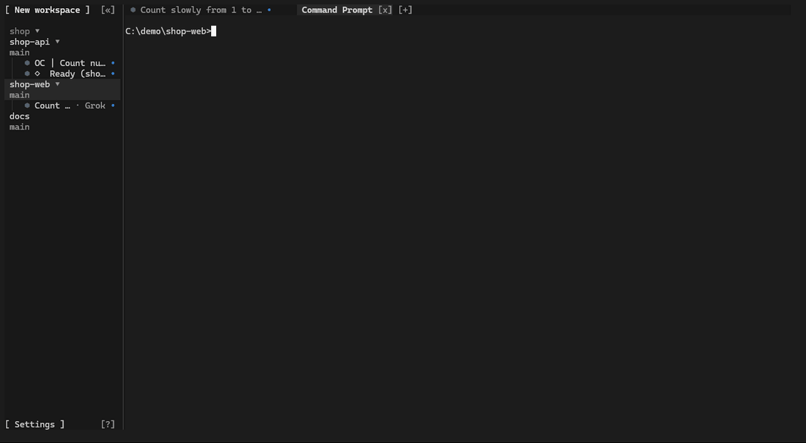
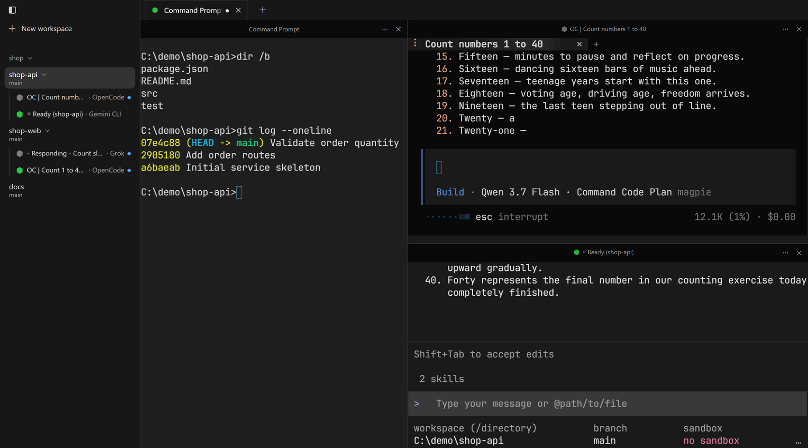

<div align="center">


# Orchbee

**A modern, multiplexed terminal for running and orchestrating AI agents.**

Sessions persist in the background and remain accessible from the terminal, the desktop, and the command line simultaneously, giving people and agents a shared environment to work in.

[](LICENSE) [](https://www.rust-lang.org) [](https://ziglang.org) [](https://www.typescriptlang.org) [](https://www.electronjs.org)

[English](README.md) · [中文](README.zh-CN.md)

[Features](#features) · [Install](#install) · [Tech Stack](#tech-stack) · [Community](#community)



</div>

---

Orchbee is a modern terminal built for the age of AI agents. It is a complete terminal first, built on the core of [Ghostty](https://ghostty.org), and everything else is built around it.

**Its core is multiplexing.** A conventional terminal session ends when its window closes. An Orchbee Session persists in the background and can be attached from several clients at once: the terminal interface, the desktop application, and the command line present and control the same Session in real time.

**This makes Orchbee a shared environment for people and agents.** Every operation available to a person is equally available to an agent through the `orchbee` command line. CLI agents such as Claude Code, Codex, OpenCode, and Pi run unchanged and gain a capability they lack on their own: **the ability to work together**.

Orchbee recognizes more than 30 agent CLIs, presents the status of each at a glance, and organizes work by project in the sidebar.

The name combines **orch**estrator with **bee**—independent workers coordinating as one.

> [!NOTE]
> Orchbee does not replace your existing CLI agents; it provides the terminal environment in which they can work together. It shifts your role from **human-in-the-loop** to **human-on-the-loop**: instead of driving every step, you supervise the system and step in when needed.

## Features

### High-Performance Terminal

<!-- TODO: Add GIF showing fast rendering with heavy output (e.g. build logs, large git diffs) -->

Terminal emulation runs in a lightweight native process built on the core of Ghostty. The terminal interface and the desktop application receive the finished screen from that process and only draw it. The desktop application renders with WebGPU, with a Canvas 2D fallback.

### Multiplexed Sessions



A Session keeps running in the background after its window is closed, along with the shells and agents in it. The terminal interface, the desktop application, and the command line can attach to the same Session at the same time, and input from one is visible in the others.

### Agent-to-Agent Collaboration



Stop managing agents one terminal at a time. Agents can prompt and spawn other agents, read each other's output, send commands across terminals, delegate tasks, and coordinate work—while you stay in control from one place.

Each step is one `orchbee` command:

```bash
orchbee agent start codex --split right
orchbee agent list
orchbee agent prompt @panel:0x36 "Review the current changes"
orchbee agent wait @panel:0x36 --until idle --timeout 120000
orchbee agent read @panel:0x36 --source recent --lines 40
```

`orchbee agent list` prints the handle of each agent, such as `@panel:0x36`.

### Agent Status and Organization



Orchbee recognizes more than 30 agent CLIs without any setup and shows the state of each one: working, needs attention, or done. The sidebar lists every agent across all projects and organizes work by project, Workspace, and Git worktree.

### Remote Machines

<!-- TODO: Add a visual showing the local machine connected to several remote machines -->

When local resources are not enough, other computers can be added over SSH to extend the compute and execution environments available to agents. Remote machines act as an extension of the local machine, and agents use them without changing their workflow. This feature is in development and is planned for the first release.

## Install

> [!IMPORTANT]
> Orchbee is in active early development. Pre-built applications are not yet available; the source checkout is currently intended for contributors.

<details>
<summary>Build from source</summary>

**Prerequisites:** Windows 11, Git, Node.js >=22, Corepack, Rust 1.97.0 through rustup, Zig 0.16.0

```bash
git clone https://github.com/i-need-token/orchbee.git
cd orchbee
corepack enable
pnpm install
```

Start the desktop application:

```bash
pnpm desktop
```

Build the terminal interface into a folder, then run the program that the command prints:

```powershell
node scripts/stage-local-runtime.mjs --output "$env:LOCALAPPDATA\OrchbeeNative"
```

</details>

## Tech Stack

- **Rust** — terminal interface, command line, and background services
- **Zig** — native terminal process
- **Ghostty VT** — terminal emulation
- **Electron** — desktop application shell
- **React** — desktop interface
- **TypeScript** — desktop application and shared package code
- **WebGPU** — GPU-accelerated terminal rendering
- **Node.js** — repository tooling

## Community

- [GitHub Issues](https://github.com/i-need-token/orchbee/issues) — bug reports and feature requests
- [Security Policy](SECURITY.md) — private vulnerability reporting

## License

[MIT](LICENSE). Third-party components are listed in [THIRD_PARTY_NOTICES.md](THIRD_PARTY_NOTICES.md).
