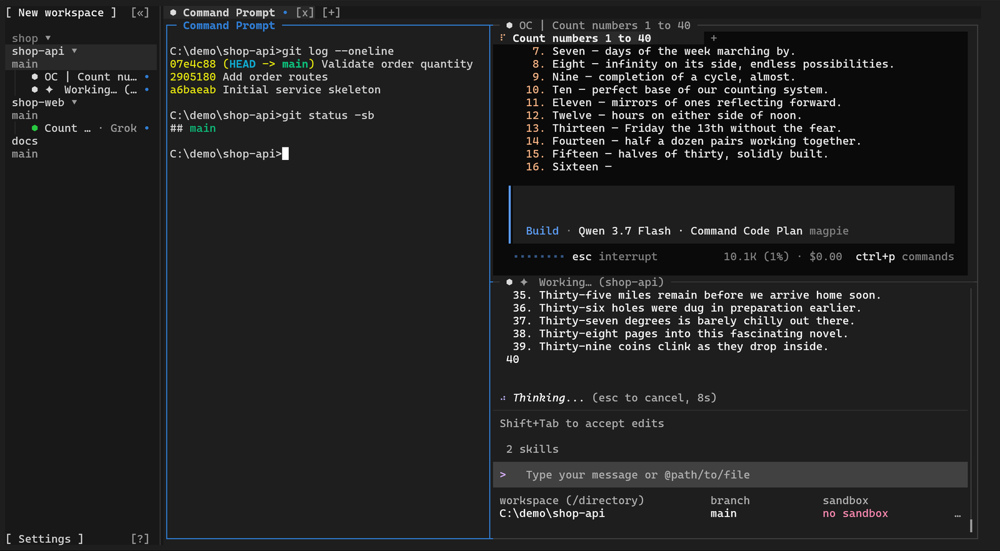
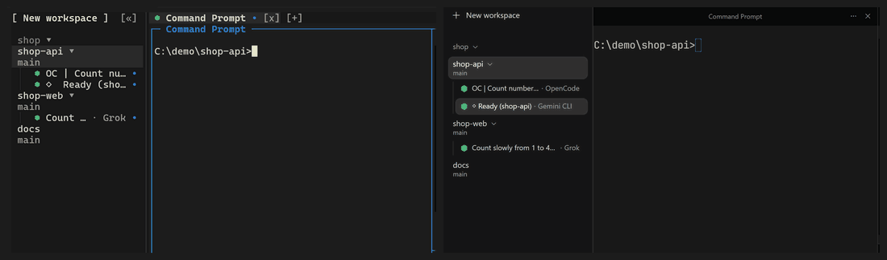
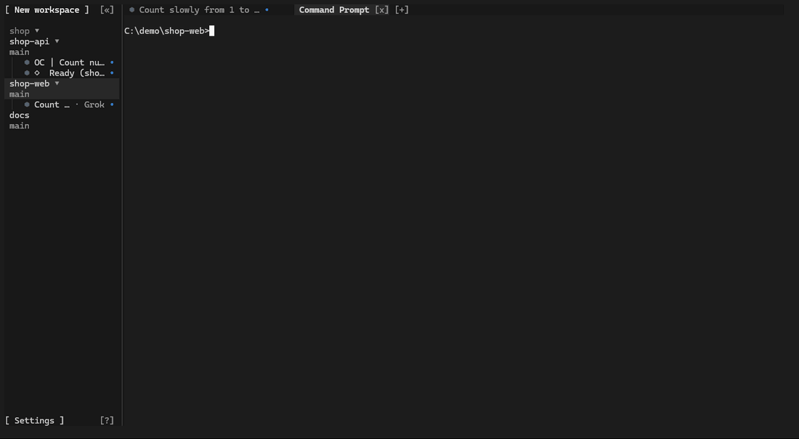
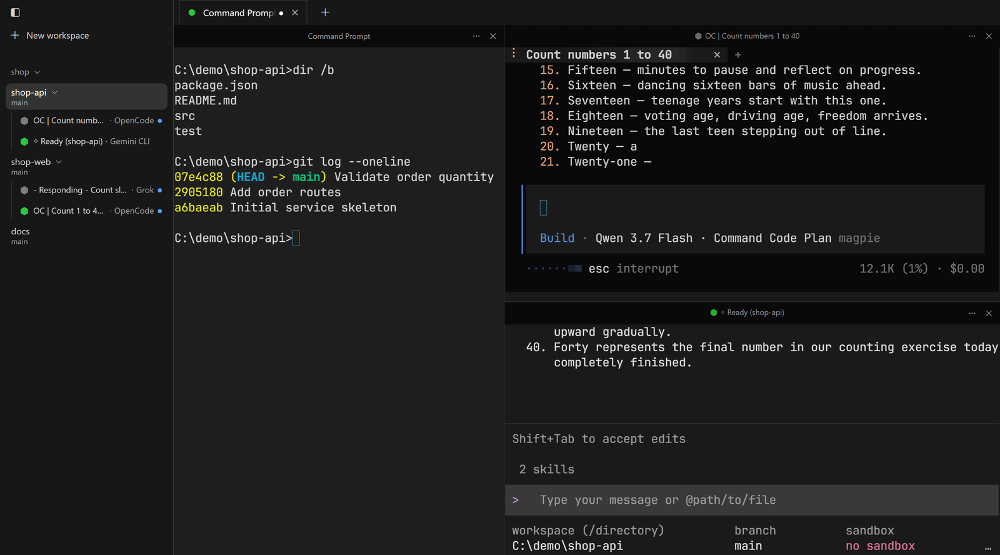

<div align="center">


# Orchbee

**一个运行和编排 AI Agent 的现代多路复用终端。**

会话在后台持续运行，可同时从终端界面、桌面应用和命令行访问，为人与 Agent 提供共同的工作环境。

[](LICENSE) [](https://www.rust-lang.org) [](https://ziglang.org) [](https://www.typescriptlang.org) [](https://www.electronjs.org)

[English](README.md) · [中文](README.zh-CN.md)

[核心特性](#核心特性) · [安装](#安装) · [技术栈](#技术栈) · [社区](#社区)



</div>

---

Orchbee 是为 AI Agent 时代打造的现代终端。它首先是一个完整的终端，基于 [Ghostty](https://ghostty.org) 的核心构建，其余能力都围绕终端展开。

**多路复用是它的核心。** 传统终端的会话随窗口关闭而结束。Orchbee 的会话在后台持续运行，并可由多个客户端同时接入：终端界面、桌面应用与命令行实时呈现并控制同一个会话。

**由此，Orchbee 成为人与 Agent 共享的工作环境。** 人可以执行的每一项操作，Agent 都可以通过 `orchbee` 命令行完成。Claude Code、Codex、OpenCode、Pi 等 CLI Agent 以原有方式运行，并获得一项自身不具备的能力：**协同工作**。

Orchbee 可识别 30 余种 CLI Agent，直观呈现每个 Agent 的状态，并在侧边栏按项目组织工作。

名字由 **orch**estrator（编排者）和 **bee**（蜜蜂）组合而来，寓意独立个体协同如一。

> [!NOTE]
> Orchbee 不替代你现有的 CLI Agent，而是提供让它们协同工作的终端环境。它让你的角色从 **human-in-the-loop** 转向 **human-on-the-loop**：不再亲自推动每一步，而是监督整个系统，并在必要时介入。

## 核心特性

### 高性能终端

<!-- TODO: 添加 GIF 展示大量输出（如构建日志、大型 git diff）下的流畅渲染 -->

终端模拟运行在一个基于 Ghostty 核心构建的轻量原生进程中。终端界面与桌面应用从该进程接收处理好的画面，只负责绘制。桌面应用使用 WebGPU 渲染，并提供 Canvas 2D 后备。

### 会话多路复用



会话在窗口关闭后继续在后台运行，其中的 Shell 与 Agent 不会中断。终端界面、桌面应用与命令行可以同时接入同一个会话，在一处输入，其他各处同步可见。

### Agent 间协作



不再逐个盯着彼此孤立的终端。Agent 可以 prompt 和拉起其他 Agent、读取彼此的输出、跨终端发送命令、分派任务并协同推进；你只需在一个地方掌握全局。

每一步都是一条 `orchbee` 命令：

```bash
orchbee agent start codex --split right
orchbee agent list
orchbee agent prompt @panel:0x36 "Review the current changes"
orchbee agent wait @panel:0x36 --until idle --timeout 120000
orchbee agent read @panel:0x36 --source recent --lines 40
```

`orchbee agent list` 会列出每个 Agent 的句柄，例如 `@panel:0x36`。

### Agent 状态与组织



Orchbee 无需任何配置即可识别 30 余种 CLI Agent，并显示每个 Agent 的状态：运行中、需要处理或完成。侧边栏列出所有项目中的每个 Agent，并按项目、工作区和 Git 工作树组织工作。

### 远程机器

<!-- TODO: 添加示意图，展示本机与多台远程机器的连接 -->

当本机资源不足时，可通过 SSH 添加其他机器，为 Agent 扩展算力和运行环境。远程机器是本机能力的延伸，Agent 无需改变原有使用方式。该功能正在开发中，计划随首个版本提供。

## 安装

> [!IMPORTANT]
> Orchbee 处于测试阶段，目前支持 Windows 11（x86_64）；macOS 和 Linux 版本正在开发中。

### 桌面应用、终端和 CLI

从[发布页](https://github.com/i-need-token/orchbee/releases)下载
`Orchbee-<version>-windows-x86_64-setup.exe` 并运行。

- 只为当前用户安装，不需要管理员权限。
- 会把 `orchbee` 命令加入 `Path`，新开一个终端即可使用。
- 安装程序暂未做代码签名，Windows SmartScreen 可能会要求你确认。

### 仅终端和 CLI

```powershell
npm install -g orchbee@next
```

需要 Node.js 22 或更高版本。这种方式安装终端界面和 CLI，不含桌面应用。

### 启动

```powershell
orchbee          # 打开终端界面
```

也可以从开始菜单打开 **Orchbee**。

### 卸载

在**设置 › 应用**中移除 Orchbee，或运行 `orchbee uninstall`。通过 npm 安装的，先运行
`orchbee uninstall`，再运行 `npm rm -g orchbee`。`~/.orchbee` 中的数据会保留；加上
`--delete-data` 可一并删除。

<details>
<summary>从源码构建</summary>

**前置条件：** Windows 11、Git、Node.js >=22、Corepack、通过 rustup 安装的 Rust 1.97.0、Zig 0.16.0

```bash
git clone https://github.com/i-need-token/orchbee.git
cd orchbee
corepack enable
pnpm install
```

启动桌面应用：

```bash
pnpm desktop
```

将终端界面构建到一个文件夹，然后运行命令输出的程序：

```powershell
node scripts/stage-local-runtime.mjs --output "$env:LOCALAPPDATA\OrchbeeNative"
```

</details>

## 技术栈

- **Rust** — 终端界面、命令行与后台服务
- **Zig** — 原生终端进程
- **Ghostty VT** — 终端模拟
- **Electron** — 桌面应用外壳
- **React** — 桌面端界面
- **TypeScript** — 桌面应用与共享包代码
- **WebGPU** — GPU 加速终端渲染
- **Node.js** — 仓库工具

## 社区

- [GitHub Issues](https://github.com/i-need-token/orchbee/issues) — Bug 报告与功能请求
- [安全政策](SECURITY.md) — 私下报告安全漏洞

## 许可证

[MIT](LICENSE)。第三方组件见 [THIRD_PARTY_NOTICES.md](THIRD_PARTY_NOTICES.md)。
