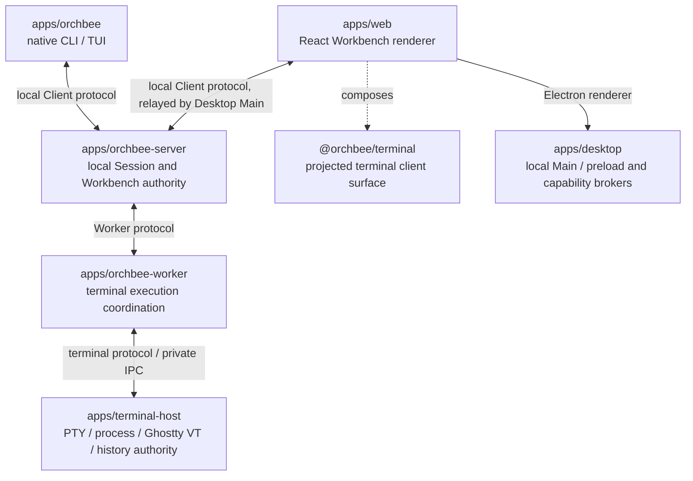

# Architecture

## Dependency direction

```text
apps/* (JavaScript / TypeScript) -> packages/* -> external dependencies
apps/* (Rust)                  -> crates/*   -> external dependencies
```

- Apps are runtime entry points and never dependencies of packages, crates, or other apps.
- Packages may depend on other packages only through their declared package exports.
- Rust crates may depend on other crates only through declared Cargo dependencies.
- Code shared by multiple apps belongs in the language-appropriate package or crate after it has a
  stable semantic owner and real consumers. Cross-language sharing uses an accepted serialized
  contract, not source imports.

## Product runtime modules

Product roles and identity boundaries use the [Glossary](GLOSSARY.md). A TUI Workbench Client owns
its local interaction runtime; each accepted Client–Server transport is one Client Connection.
Neither lifecycle is a Session identity.
A TUI uses one admitted OBLC physical connection for its OBWP v1 request/subscription streams; logical lanes share it without acquiring additional Client identities. Server commit owners publish invalidations to the connection's standard-library reader/writer pair.



## Package boundaries

- Runnable product and development workspaces follow [`docs/APPLICATIONS.md`](APPLICATIONS.md).
- Package naming, manifests, public exports, builds, dependencies, and versioning follow [`docs/PACKAGES.md`](PACKAGES.md).
- Rust crate placement, manifests, visibility, dependencies, and verification follow [`docs/RUST.md`](RUST.md).
- Frontend product UI and platform adapters follow [`docs/frontend/package-boundaries.md`](frontend/package-boundaries.md).
- `orchbee/no-cross-workspace-source-imports`: Import another workspace package through its public package exports; never cross into another `apps/*/src` or `packages/*/src` tree.
- Relative imports inside one app, package, or crate follow [`docs/MODULE-BOUNDARIES.md`](MODULE-BOUNDARIES.md).
- Each package defines its public API through `package.json#exports`; `src/index.ts` implements the root export when present.

## Source module boundaries

- Source trees use hierarchical visibility and explicit `index.ts` entry points.
- [`docs/MODULE-BOUNDARIES.md`](MODULE-BOUNDARIES.md) owns semantic module design, visibility, re-export, test, composition, and cycle rules.
- `orchbee/module-boundaries` and `import/no-cycle` enforce those rules.

## Project registry

- Every workspace declares its domain, responsibility, non-goals, runtime, and stability in a schema-backed `project.json`.
- [`docs/PROJECTS.md`](PROJECTS.md) owns the contract; `pnpm lint:projects` verifies it.
- Do not maintain a project catalog in this overview.

## Data boundaries

Before the first public release, each wire protocol, persisted format, and machine-readable
document retains only its current contract. Integer versions stay at `1`; the five OBTP version
domains stay at generation 1, encoded `1.0.0`. Shape changes update that current contract directly, without historical
versions, compatibility readers, or migrations. Strict parsing rejects files with other shapes;
where it does not protect version reuse, replace the magic or schema identifier instead of retaining
an older contract.

Connections open with the `OBHS` handshake of
[`crates/connection-handshake`](../crates/connection-handshake/README.md) and
[`schemas/connection`](../schemas/connection/README.md). Before the first public release, each
negotiated connection keeps only its current protocol generation: an incompatible change advances
the generation and drops the previous one, so negotiation rejects a stale peer, and the first
public release freezes each current generation. Peers of different environments never connect, and development and test builds admit a peer only with an equal protocol fingerprint, so
an unchanged protocol lets a rebuilt Client join the running development Session while a changed
one is refused. The accepted
[versioning and upgrade direction](../proposals/platform/versioning-and-upgrade.md) sets the
compatibility rules that bind from the first public release. The
[data root layout](../proposals/platform/data-root-layout.md) places every file Orchbee writes on a
person's machine and sets the persisted-data migration rules that bind from the same release.

The language-neutral Terminal authority is [`schemas/terminal`](../schemas/terminal/README.md).
Its reference, version policy, constant registry and canonical fixtures govern the independent
Rust, Zig and TypeScript bindings. Language packages own implementation and fixture production,
not competing wire contracts.

Shared domain state and Client-local presentation follow the responsibility boundaries in
[`INTERFACE-DESIGN.md`](INTERFACE-DESIGN.md). GUI and TUI project the owning contracts; their
different renderers do not establish separate authority over the same product meaning.

Parse untrusted process, network, storage, IPC, and user-input data at its first trusted boundary; pass validated types internally.

```ts
// ❌
const payload = rawPayload as RequestPayload;

// ✅
const payload = RequestPayloadSchema.parse(rawPayload);
```
