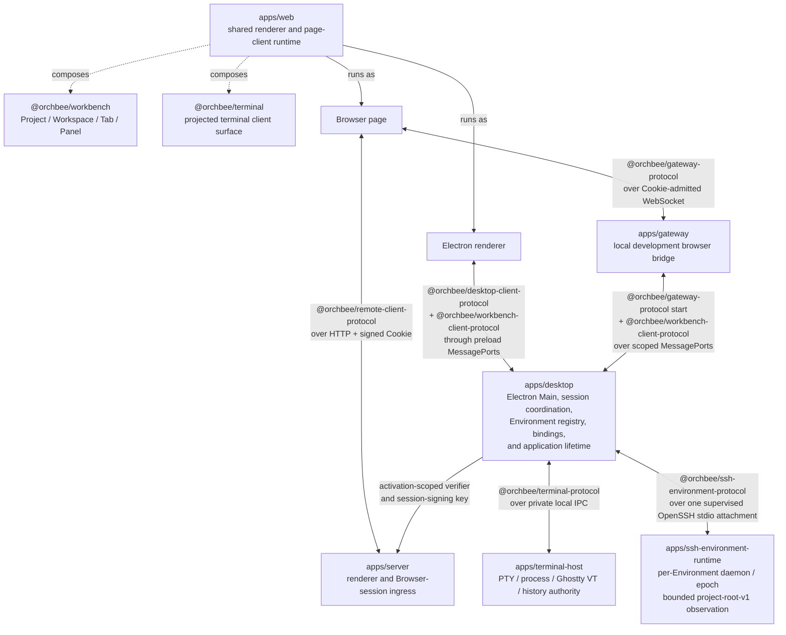

# Architecture

## Dependency direction

```text
apps/* -> packages/* -> external dependencies
```

- Apps are runtime entry points and never dependencies of packages or other apps.
- Packages may depend on other packages only through their declared package exports.
- Code shared by multiple apps belongs in a package.

## Product runtime modules



## Package boundaries

- Runnable product and development workspaces follow [`docs/APPLICATIONS.md`](APPLICATIONS.md).
- Package naming, manifests, public exports, builds, dependencies, and versioning follow [`docs/PACKAGES.md`](PACKAGES.md).
- Frontend product UI and platform adapters follow [`docs/frontend/package-boundaries.md`](frontend/package-boundaries.md).
- `orchbee/no-cross-workspace-source-imports`: Import another workspace package through its public package exports; never cross into another `apps/*/src` or `packages/*/src` tree.
- Relative imports inside one app or package follow [`docs/MODULE-BOUNDARIES.md`](MODULE-BOUNDARIES.md).
- Each package defines its public API through `package.json#exports`; `src/index.ts` implements the root export when present.

## Source module boundaries

- Source trees use hierarchical visibility and explicit `index.ts` entry points.
- [`docs/MODULE-BOUNDARIES.md`](MODULE-BOUNDARIES.md) owns semantic module design, visibility, re-export, test, composition, and cycle rules.
- `orchbee/module-boundaries` and `import/no-cycle` enforce those rules.

## Project registry

- Every workspace declares its domain, responsibility, non-goals, runtime, and stability in a schema-backed `project.json`.
- [`docs/PROJECTS.md`](PROJECTS.md) owns the contract; `pnpm lint:projects` verifies it.
- Do not maintain a project catalog in this overview.

## Data boundaries

Parse untrusted process, network, storage, IPC, and user-input data at its first trusted boundary; pass validated types internally.

```ts
// ❌
const payload = rawPayload as RequestPayload;

// ✅
const payload = RequestPayloadSchema.parse(rawPayload);
```
