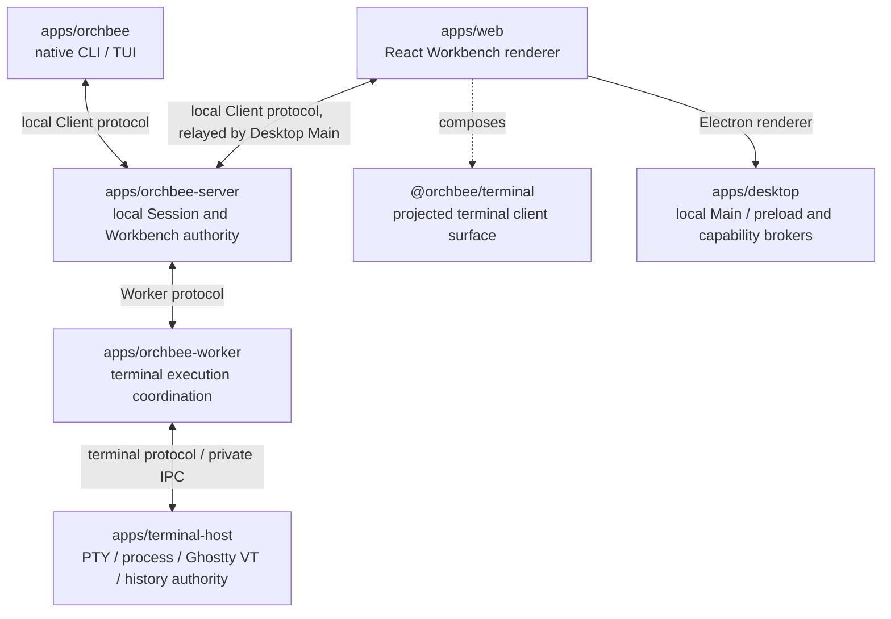

# Architecture

## Dependency direction

```text
apps/* (JavaScript / TypeScript) -> packages/* -> external dependencies
apps/* (Rust)                  -> crates/*   -> external dependencies
```

- Apps are runtime entry points and never dependencies of packages, crates, or other apps.
- Packages may depend on other packages only through their declared package exports.
- Rust crates may depend on other crates only through declared Cargo dependencies.
- Code shared by multiple apps belongs in the language-appropriate package or crate after it has a
  stable semantic owner and real consumers. Cross-language sharing uses an accepted serialized
  contract, not source imports.

## Product runtime modules

Product roles and identity boundaries use the [Glossary](GLOSSARY.md). A TUI Workbench Client owns
its local interaction runtime; each accepted Client–Server transport is one Client Connection.
Neither lifecycle is a Session identity.
A TUI uses one admitted OBLC physical connection for its OBWP v1 request/subscription streams; logical lanes share it without acquiring additional Client identities. Server commit owners publish invalidations to the connection's standard-library reader/writer pair.



## Package boundaries

- Runnable product and development workspaces follow [`docs/APPLICATIONS.md`](APPLICATIONS.md).
- Package naming, manifests, public exports, builds, dependencies, and versioning follow [`docs/PACKAGES.md`](PACKAGES.md).
- Rust crate placement, manifests, visibility, dependencies, and verification follow [`docs/RUST.md`](RUST.md).
- Frontend product UI and platform adapters follow [`docs/frontend/package-boundaries.md`](frontend/package-boundaries.md).
- `orchbee/no-cross-workspace-source-imports`: Import another workspace package through its public package exports; never cross into another `apps/*/src` or `packages/*/src` tree.
- Relative imports inside one app, package, or crate follow [`docs/MODULE-BOUNDARIES.md`](MODULE-BOUNDARIES.md).
- Each package defines its public API through `package.json#exports`; `src/index.ts` implements the root export when present.

## Source module boundaries

- Source trees use hierarchical visibility and explicit `index.ts` entry points.
- [`docs/MODULE-BOUNDARIES.md`](MODULE-BOUNDARIES.md) owns semantic module design, visibility, re-export, test, composition, and cycle rules.
- `orchbee/module-boundaries` and `import/no-cycle` enforce those rules.

## Project registry

- Every workspace states what it is responsible for and what it never does in its own README, under [package documents](DOCUMENTATION.md#package-documents).
- Do not maintain a project catalog in this overview.

## Data boundaries

Each wire protocol, persisted format, and machine-readable document retains only its current
contract. A version number moves only when a reader must refuse the new shape rather than misread
it, as the Server-Worker codec (`2`) and the signed release manifest (`schemaVersion: 2`) did; the
public update feed stays frozen at `schemaVersion: 1`, and a breaking change takes a new feed path.
The five OBTP version domains stay at generation 1, encoded `1.0.0`, and connections settle
compatibility one connection at a time in the handshake below. Shape changes update that current
contract directly, without historical versions, compatibility readers, or migrations. Strict
parsing rejects files with other shapes; where it does not protect version reuse, replace the magic
or schema identifier instead of retaining an older contract.

Connections open with the `OBHS` handshake of
[`crates/connection-handshake`](../crates/connection-handshake/README.md) and
[`schemas/connection`](../schemas/connection/README.md). Every negotiated connection stays at
generation 1 and changes shape in place, like the formats above; no change advances a generation or
drops one. Release builds compare no fingerprint, so release builds of different versions accept
each other at generation 1, and strict parsing refuses any message whose shape changed between
them. Peers of different environments never connect, and development and test builds admit a peer
only with an equal protocol fingerprint, so an unchanged protocol lets a rebuilt Client join the
running development Session while a changed one is refused.

The accepted [versioning and upgrade direction](../proposals/platform/versioning-and-upgrade.md)
replaces these connection rules with its
[compatibility window](../proposals/platform/versioning-and-upgrade.md#compatibility-window) from
the first automatic-update release, 0.1.0-beta.14, which this tree builds; the rules above describe
the releases before it. The
[data root layout](../proposals/platform/data-root-layout.md) places every file Orchbee writes on a
person's machine and sets the persisted-data migration rules and the release from which each
applies.

The language-neutral Terminal authority is [`schemas/terminal`](../schemas/terminal/README.md).
Its reference, version policy, constant registry and canonical fixtures govern the independent
Rust, Zig and TypeScript bindings. Language packages own implementation and fixture production,
not competing wire contracts.

Shared domain state and Client-local presentation follow the responsibility boundaries in
[`INTERFACE-DESIGN.md`](INTERFACE-DESIGN.md). GUI and TUI project the owning contracts; their
different renderers do not establish separate authority over the same product meaning.

Parse untrusted process, network, storage, IPC, and user-input data at its first trusted boundary; pass validated types internally.

```ts
// ❌
const payload = rawPayload as RequestPayload;

// ✅
const payload = RequestPayloadSchema.parse(rawPayload);
```

## Fault containment

A process that holds independent units of work, such as terminals, viewers, attachments, or
Client connections, contains every fault to the units it damaged. A peer's message, a contract
violation, or a slow system call never takes down work it did not touch.

- **Prevention first.** Contain a fault at the boundary that received it. Recovery, such as a
  restart, reattach, or reconnect, is the safety net for faults that containment did not stop; it
  never replaces containment of the input that caused the fault.
- **Smallest scope.** Name what a fault damaged and fail no wider: one request gets a typed refusal,
  one viewer, attachment, or controller closes alone, and a connection whose framing is lost ends
  alone. An intact message that is unexpected, late, stray, refused, or outside its contract is
  dropped or answered and recorded. A malformed or unexpected peer message ends at most that peer's
  connection, never the receiving process; a process left with nothing to serve then follows Exit
  last. Never end a process that holds other work for a fault in one of its units.
- **Own the boundary.** Each side of a process boundary handles its peer's loss, silence, or bad
  data itself: it records the class, fails only what depended on the peer, and keeps serving the
  rest. It never relies on the peer to clean up or to exit first.
- **Own the outcomes.** A process checks each outcome it builds for a peer before sending it. An
  outcome that fails its own check becomes the most conservative outcome the contract defines, is
  recorded with its class and site, and does not end the process.
- **Transient failures.** A transient failure of a shared operation, such as an accept, a read, or a
  record write, drops or retries only the work it affected and never ends the process.
- **Late is not invalid.** Time is not evidence of misbehavior. An intact answer that arrives after
  its caller stopped waiting is still well formed; a peer is lost only when it stays silent past
  its hard bound.
- **Keep the class.** A failure keeps its class, site, reason, and peer from detection to its
  record, and no layer relabels it as another class. Every contained fault and every abnormal end
  writes a record of closed tokens and numbers, never content.
- **Hard bounds.** Every wait on a peer or on the operating system has a hard bound below the
  waiting peer's own timeout. A wait that can block, such as a filesystem or account lookup, runs
  off the thread that serves peers, and its late result is dropped. In each pair of processes that
  write to each other, at least one side keeps reading while its own write waits, so two full
  buffers can never leave both sides waiting.
- **Fence the unit.** An invariant violated after a unit's state commits fences that unit: the
  process stops serving it, closes its clients with a typed record, and keeps serving its other
  units. The process exits for such an invariant only when the violated state is shared by its
  units.
- **Exit last.** A process that holds user work exits last, and only for a cause that damages that
  work, such as the loss of the connection all of it is served through, or an invariant of its own
  whose violation would corrupt state or act without authority.

No lint rule enforces this section; review does. Reviewers check that each path that peer input
reaches ends in a typed refusal, a drop, a fence, or a connection end, and never in a process exit
unless Exit last applies; that each failed outcome check maps to a contract outcome; that each
blocking write has a concurrent reader or a bound; and that a recovery change for an
input-triggered fault also contains that input at its boundary.
[Regression coverage](TESTING.md#regression-coverage) states the evidence.

Language rules apply these principles in [Rust](RUST.md#errors-and-panic-boundaries) and
[Zig](ZIG.md#boundaries-and-safety).
