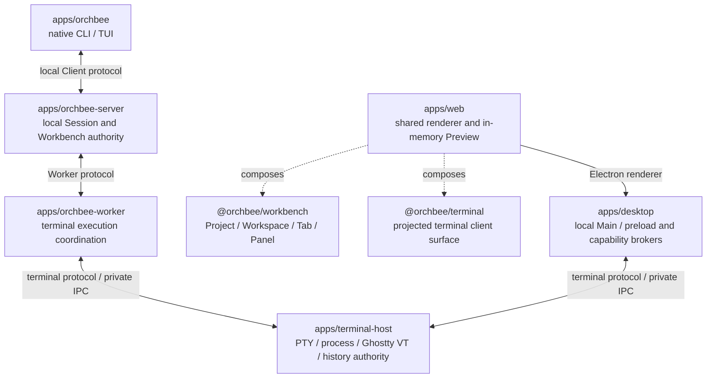

# 架构

## 依赖方向

```text
apps/*（JavaScript / TypeScript）-> packages/* -> 外部依赖
apps/*（Rust）                 -> crates/*   -> 外部依赖
```

- 应用是运行时入口，绝不能成为 package、crate 或其他应用的依赖。
- 包只能通过其他包声明的包导出来依赖它们。
- Rust crate 只能通过声明的 Cargo dependency 依赖其他 crate。
- 多个应用共享的代码只有具备稳定 semantic owner 和真实 consumer 后，才进入语言对应的 package
  或 crate。跨语言共享使用已接受的 serialized contract，不使用源码 import。

## 产品运行时模块

产品角色与身份边界使用[术语表](GLOSSARY.md)。TUI Workbench Client 拥有本地交互运行时；
每条已接受的 Client–Server 传输对应一个 Client Connection。这两种生命周期均不是 Session 身份。



## 包边界

- 可运行的产品和开发工作区遵循 [`docs/APPLICATIONS.md`](APPLICATIONS.md)。
- 包的命名、清单、公共导出、构建、依赖和版本管理遵循 [`docs/PACKAGES.md`](PACKAGES.md)。
- Rust crate 的位置、清单、可见性、依赖和验证遵循 [`docs/RUST.md`](RUST.md)。
- 前端产品 UI 和平台适配器遵循 [`docs/frontend/package-boundaries.md`](frontend/package-boundaries.md)。
- `orchbee/no-cross-workspace-source-imports`：通过其他工作区包的公共包导入来使用它；绝不能跨入其他 `apps/*/src` 或 `packages/*/src` 源码树。
- 同一个应用、package 或 crate 内的相对 import 遵循 [`docs/MODULE-BOUNDARIES.md`](MODULE-BOUNDARIES.md)。
- 每个包通过 `package.json#exports` 定义公共 API；存在根导出时，由 `src/index.ts` 实现。

## 源模块边界

- 源码树使用分层可见性和显式 `index.ts` 入口点。
- [`docs/MODULE-BOUNDARIES.md`](MODULE-BOUNDARIES.md) 负责语义模块设计、可见性、重新导出、测试、组合和循环依赖规则。
- `orchbee/module-boundaries` 和 `import/no-cycle` 强制执行这些规则。

## 项目注册表

- 每个工作区都在基于 Schema 的 `project.json` 中声明其领域、职责、非目标、运行时和稳定性。
- [`docs/PROJECTS.md`](PROJECTS.md) 负责该契约；`pnpm lint:projects` 验证它。
- 不要在本概览中维护项目目录。

## 数据边界

首次公开发布前，每个线协议、持久化格式和机器可读文档只保留当前契约。整数版本保持为 `1`，
OBTP 的五个版本域保持为 `0.1.0`。形状变化直接修改当前契约，不保留历史版本、兼容读取或迁移。
其他形状的对端和文件由 cohort 准入或严格解析拒绝；若两者都无法保护版本号复用，
则更换 magic 或 schema 标识，而不保留旧契约。

语言中立的 Terminal 权威位于 [`schemas/terminal`](../../schemas/terminal/README.zh-CN.md)。
其参考、版本政策、常量注册表和规范夹具管理独立的 Rust、Zig 和 TypeScript 绑定。
语言包负责实现和夹具生产，不建立竞争的线协议契约。

共享领域状态与 Client 本地呈现遵循 [`INTERFACE-DESIGN.md`](INTERFACE-DESIGN.md) 的职责边界。
GUI 和 TUI 投影所属契约；渲染器不同不构成对同一产品含义分别建立权威的理由。

在不可信的进程、网络、存储、IPC 和用户输入数据首次进入可信边界时解析它们；在内部传递经过验证的类型。

```ts
// ❌
const payload = rawPayload as RequestPayload;

// ✅
const payload = RequestPayloadSchema.parse(rawPayload);
```

<!-- documentation-pairing: english-sha256=a67863acbf260084f520a2072be1750e0af57033ae36420231a3daac82e29de8 zh-cn-sha256=143e2c9035ce3b6d97ad81cd08745d53f11fbfa1024a0b9aa4fe461f8c9ef08c -->
